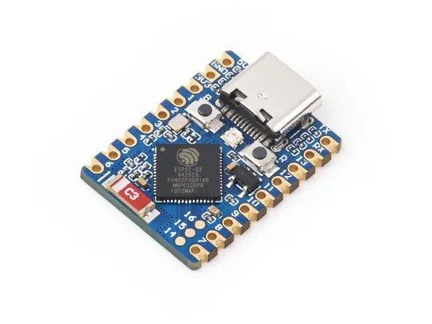
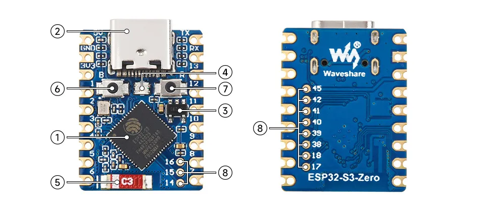
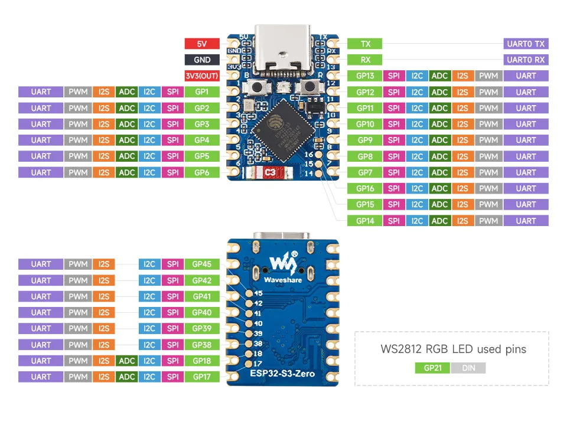
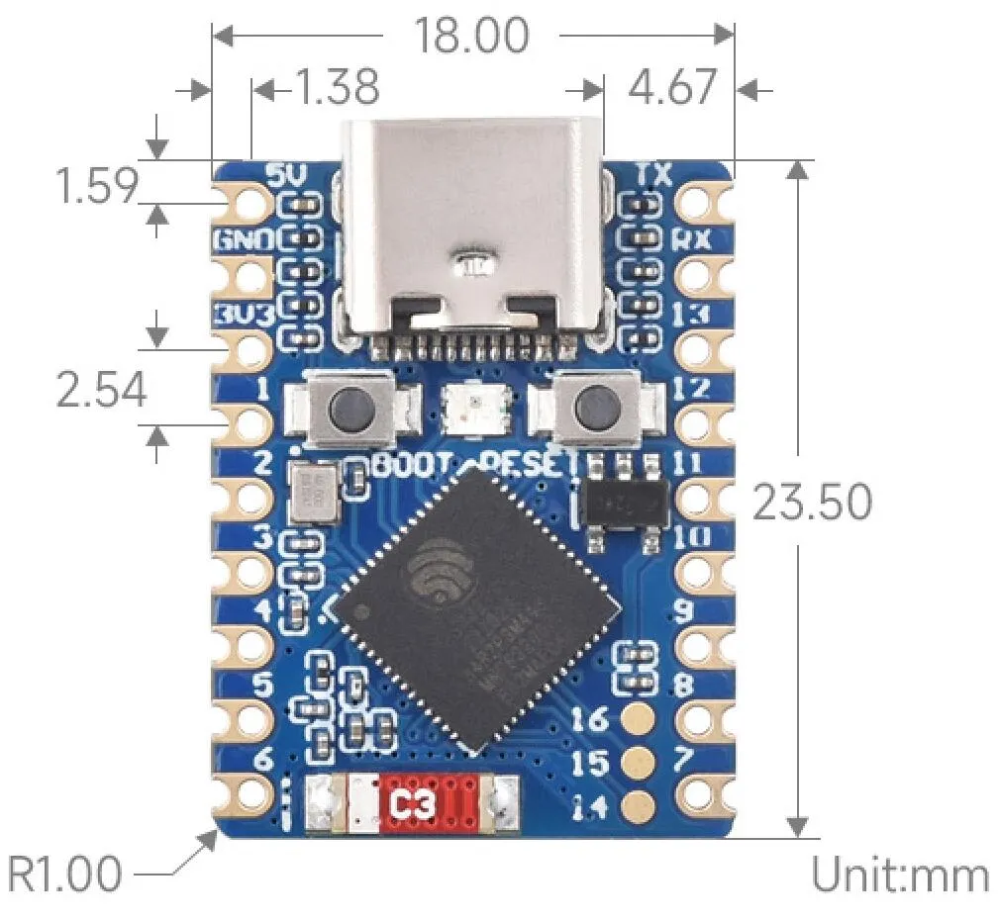

# Development Board — Waveshare ESP32-S3-Zero

## 1. Overview

The **Waveshare ESP32-S3-Zero** is an ultra-compact mini development board based on the Espressif **ESP32-S3FH4R2** system-on-chip. It features a castellated edge module form-factor (RP2040-Zero style) with an onboard Type-C USB port, ceramic antenna, WS2812 RGB LED, and 2.54 mm pitch pin headers.



* **Manufacturer**: Waveshare
* **Product Page & Official Wiki**: [Waveshare ESP32-S3-Zero Documentation](https://docs.waveshare.com/ESP32-S3-Zero?variant=ESP32-S3-Zero)
* **Form Factor**: 23.5 × 18.0 mm (castellated pads with 2.54 mm standard pin spacing)

---

## 2. Technical Specifications

| Parameter | Specification |
|---|---|
| **MCU** | Espressif ESP32-S3FH4R2 |
| **CPU** | Xtensa® 32-bit LX7 dual-core processor, up to 240 MHz |
| **Vector Instructions** | Vector extension instructions for AI/DSP acceleration |
| **SRAM** | 512 KB internal SRAM |
| **ROM** | 384 KB internal ROM |
| **Flash Memory** | 4 MB Quad-SPI Flash (in-package) |
| **PSRAM** | 2 MB Quad-SPI PSRAM (in-package) |
| **Wireless** | 2.4 GHz Wi-Fi (802.11 b/g/n) & Bluetooth® 5 (LE) |
| **Antenna** | Onboard ceramic antenna |
| **USB** | USB Type-C connector connected to ESP32-S3 native USB full-speed controller (CDC/JTAG) |
| **LDO Regulator** | ME6217C33M5G (5V to 3.3V, up to 800 mA output current) |
| **Input Voltage** | 5V via USB-C or `5V` (VBUS) pin |
| **Logic Voltage** | 3.3 V |
| **User Controls** | `BOOT` button (GPIO 0) and `RESET` button |
| **Onboard LED** | Addressable WS2812 RGB LED connected to **GPIO 21** |

---

## 3. Board Resources & Components



1. **ESP32-S3FH4R2 Processor**: Dual-core processor with 4 MB Flash and 2 MB PSRAM.
2. **ME6217C33M5G Low-Dropout Regulator**: Converts 5V down to 3.3V with low noise and up to 800 mA output.
3. **WS2812 RGB LED**: User-controllable RGB LED driven via **GPIO 21**.
4. **Ceramic Antenna**: 2.4 GHz Wi-Fi and Bluetooth LE RF antenna.
5. **RESET Button**: Pulls `CHIP_PU` low to reset the microcontroller.
6. **BOOT Button**: Connected to `GPIO 0`. Held down during power-up/reset to enter ROM bootloader (UART/USB download mode).
7. **USB Type-C Connector**: Supports native USB OTG, USB Serial/JTAG debugging, and board power supply.

---

## 4. Pinout & Dimensions

### Pinout Diagram



### Dimensions



- Board Dimensions: **23.50 mm × 18.00 mm**
- Pin Pitch: **2.54 mm (0.1 in)**
- Pad Type: Castellated holes suitable for surface-mount soldering or male pin header through-hole soldering.

---

## 5. Pin Table & Peripheral Mapping

The ESP32-S3 features an internal GPIO matrix, allowing most digital peripherals (SPI, I2C, UART, PWM) to be routed to any available GPIO.

### Left Header (Looking from Top, USB at Bottom)

| Pin # | Label | Primary Function | Secondary / Alternate Functions | Notes |
|:---:|:---|:---|:---|:---|
| 1 | `5V` | 5V Power In / VBUS | Power input (or 5V output when USB powered) | Diode protected from USB |
| 2 | `GND` | Ground | System Ground | |
| 3 | `3V3` | 3.3V Power Output | Output from ME6217 regulator (max 800 mA) | Powers external 3.3V sensors & displays |
| 4 | `GP0` | GPIO 0 | RTC_GPIO0, ADC1_CH0 | Strapping pin (`BOOT` button; must be HIGH to boot normally) |
| 5 | `GP1` | GPIO 1 | RTC_GPIO1, ADC1_CH1, TOUCH1 | General Purpose I/O |
| 6 | `GP2` | GPIO 2 | RTC_GPIO2, ADC1_CH2, TOUCH2 | General Purpose I/O |
| 7 | `GP3` | GPIO 3 | RTC_GPIO3, ADC1_CH3, TOUCH3 | General Purpose I/O |
| 8 | `GP4` | GPIO 4 | RTC_GPIO4, ADC1_CH4, TOUCH4 | General Purpose I/O |
| 9 | `GP5` | GPIO 5 | RTC_GPIO5, ADC1_CH5, TOUCH5 | General Purpose I/O |
| 10 | `GP6` | GPIO 6 | RTC_GPIO6, ADC1_CH6, TOUCH6 | General Purpose I/O |
| 11 | `GP7` | GPIO 7 | RTC_GPIO7, ADC1_CH7, TOUCH7 | General Purpose I/O |
| 12 | `GP8` | GPIO 8 | RTC_GPIO8, ADC1_CH8, TOUCH8 | General Purpose I/O |
| 13 | `GP9` | GPIO 9 | RTC_GPIO9, ADC1_CH9, TOUCH9 | General Purpose I/O |
| 14 | `GP10` | GPIO 10 | RTC_GPIO10, ADC1_CH10, TOUCH10 | General Purpose I/O |
| 15 | `GP11` | GPIO 11 | RTC_GPIO11, ADC1_CH11, TOUCH11 | General Purpose I/O |

### Right Header (Looking from Top, USB at Bottom)

| Pin # | Label | Primary Function | Secondary / Alternate Functions | Notes |
|:---:|:---|:---|:---|:---|
| 16 | `TX` | GPIO 43 | U0TXD (UART0 TX) | Default UART transmit for boot console / logging |
| 17 | `RX` | GPIO 44 | U0RXD (UART0 RX) | Default UART receive |
| 18 | `GP21` | GPIO 21 | Onboard WS2812 RGB LED | Hardwired to RGB LED; avoid external conflicts |
| 19 | `GP20` | GPIO 20 | USB_D+ (USB Native D+) | USB D+ line |
| 20 | `GP19` | GPIO 19 | USB_D- (USB Native D-) | USB D- line |
| 21 | `GP18` | GPIO 18 | RTC_GPIO18, TOUCH14 | General Purpose I/O |
| 22 | `GP17` | GPIO 17 | RTC_GPIO17, ADC2_CH6 | General Purpose I/O |
| 23 | `GP16` | GPIO 16 | RTC_GPIO16, ADC2_CH5 | General Purpose I/O |
| 24 | `GP15` | GPIO 15 | RTC_GPIO15, ADC2_CH4 | General Purpose I/O |
| 25 | `GP14` | GPIO 14 | RTC_GPIO14, ADC2_CH3 | General Purpose I/O |
| 26 | `GP13` | GPIO 13 | RTC_GPIO13, ADC2_CH2 | General Purpose I/O |
| 27 | `GP12` | GPIO 12 | RTC_GPIO12, ADC2_CH1 | General Purpose I/O |
| 28 | `GP48` | GPIO 48 | SPICLK_P_DIFF | General Purpose I/O |
| 29 | `GP47` | GPIO 47 | SPICLK_N_DIFF | General Purpose I/O |
| 30 | `GND` | Ground | System Ground | |

> **Reserved Pins Note:** GPIO 33 through GPIO 37 are internally bonded to the in-package Quad/Octal SPI Flash and PSRAM bus. They are **not exposed** on headers and must never be accessed directly.

---

## 6. Strapping Pins & Boot Configuration

| GPIO | Purpose | Default State | Normal Boot Mode | Download / Flashing Mode |
|---|---|---|---|---|
| **GPIO 0** | Boot mode select | Pulled HIGH internally | HIGH | LOW (Hold `BOOT` button down) |
| **GPIO 45** | VDD_SPI voltage selection | Internal pull-down | 3.3 V flash operation | Do not pull HIGH during boot |
| **GPIO 46** | ROM messages printing | Internal pull-down | LOW (Normal output) | Determines early UART logging |

---

## 7. Flashing & Serial Monitor

The ESP32-S3-Zero does not use an external CH340 or CP2102 chip. It uses the ESP32-S3 internal USB Serial/JTAG controller:
- Connect the USB-C cable directly to your PC.
- In ESP-IDF:
  ```bash
  idf.py -p COMx flash monitor
  ```
- If the port fails to respond or you have bricked firmware:
  1. Hold down the **BOOT** button.
  2. Press and release the **RESET** button.
  3. Release the **BOOT** button.
  4. The board will now be in download mode (`ESP32-S3 ROM Download Mode`).

---

## 8. Display Interface Recommendations

For interfacing with the **Zhongjingyuan ZJY169S0800TG01** SPI display, the following pinout is suggested using the ESP32-S3 SPI2 (FSPI) host:

| Display Pin | Function | Suggested ESP32-S3-Zero Pin | Reason / Capabilities |
|---|---|---|---|
| **GND** | Ground | `GND` (Pin 2 or 30) | Common ground |
| **VCC** | 3.3V Power | `3V3` (Pin 3) | Powers display logic & backlight |
| **SCL** | SPI Clock (SCLK) | `GPIO 4` | Fast GPIO, general IO |
| **SDA** | SPI MOSI (Data In) | `GPIO 6` | Fast GPIO, general IO |
| **RES** | Reset | `GPIO 5` | Active-low display reset |
| **DC** | Data / Command | `GPIO 7` | D/C line selector |
| **CS** | Chip Select | `GPIO 8` | Hardware or software CS (active low) |
| **BLK** | Backlight Control | `GPIO 9` | LEDC PWM controllable for brightness |

