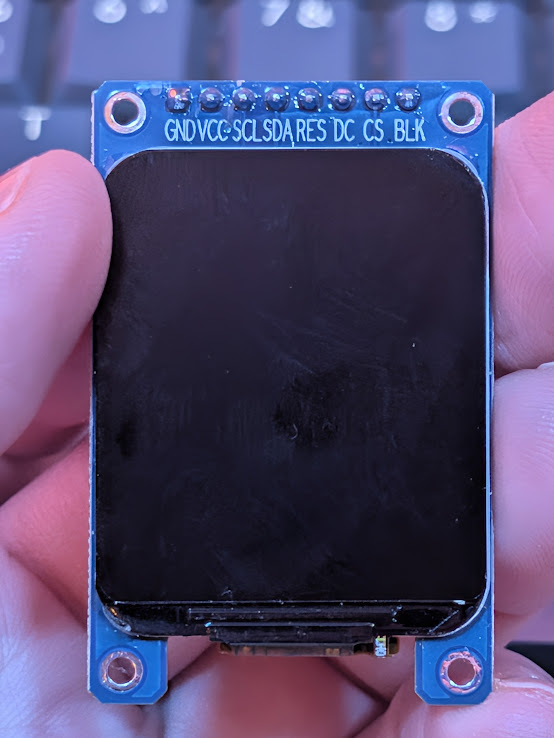
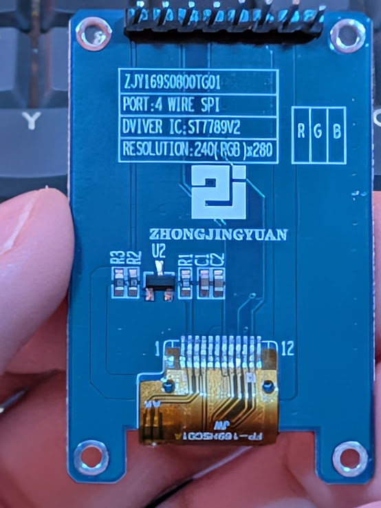
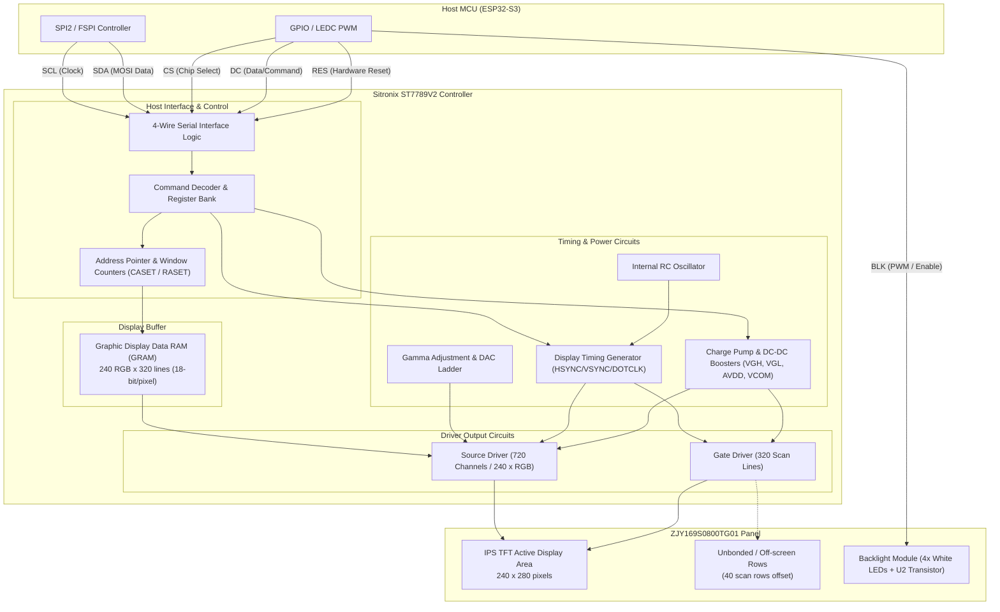

# Display Hardware — Zhongjingyuan 1.69-inch ST7789V2 TFT

## 1. Hardware identification

The module is identified from the markings on the back of the PCB:

```text
ZJY169S0800TG01
PORT: 4 WIRE SPI
DRIVER IC: ST7789V2
RESOLUTION: 240(RGB) x 280
ZHONGJINGYUAN
```

| Property | Value |
|---|---|
| Manufacturer / brand | Zhongjingyuan (ZHONGJINGYUAN) |
| Module model | `ZJY169S0800TG01` |
| Display | 1.69-inch IPS TFT LCD, normally black |
| Controller | Sitronix ST7789V2 |
| Active resolution | **240 × 280** pixels (portrait) |
| Active area (AA) | **27.97 × 32.63 mm** (~0.1166 mm/pixel pitch, ~218 PPI) |
| Corner geometry | **Rounded corners**, radius **$R \approx 3.5\text{ mm}$** ($\approx 30\text{ pixels}$) |
| Interface | **4-wire SPI** (clock, MOSI, D/C, chip select) plus reset and backlight |
| Supply and logic | **3.3 V** (do not use 5 V) |
| Color format | RGB, 16-bit RGB565 (65,536 colors) supported |
| Connector | 8-pin, 2.54 mm pitch |
| Touch input | None on this module |
| Backlight | White LEDs, controllable |
| Operating temperature | −20 °C to +70 °C (vendor specification) |
| Approx. PCB dimensions | 31 × 48 mm (vendor listing; check mechanical fit before fabrication) |

### Photos

| Front (Display Side) | Back (PCB & Silkscreen) |
|:---:|:---:|
|  |  |

> **Model-specific caveat:** Some documents for similarly named Zhongjingyuan modules describe a **10-pin version with an auxiliary font chip**. This specific photographed module has **8 pins**. Follow the silkscreen on the actual PCB, not a pinout from another revision.

---

## 2. Display connector pinout

**Viewing orientation:** Looking at the front of the display with its connector across the top, the printed pin sequence runs left to right:

```text
┌────────────────────────────────────────────┐
│ GND VCC SCL SDA RES DC CS BLK              │  ← top connector
│                                            │
│             LCD front                      │
│                                            │
└────────────────────────────────────────────┘
```

| Pin | Printed label | Meaning | Notes |
|:---:|---|---|---|
| 1 | `GND` | Ground | Must share ground with MCU |
| 2 | `VCC` | 3.3 V power input | **Never connect to 5 V** |
| 3 | `SCL` | SPI clock (SCLK) | **Not an I²C clock** |
| 4 | `SDA` | SPI data input (MOSI/COPI) | **Not an I²C data line** |
| 5 | `RES` | Display reset | Active low hardware reset |
| 6 | `DC` | Data / Command selection | Low = Command, High = Data (GPIO output) |
| 7 | `CS` | SPI chip select | Active low chip select |
| 8 | `BLK` | Backlight control | Digital ON/OFF (High = ON, Low = OFF); see Section 6 before using PWM |

There is **no MISO** pin: normal operation is write-only SPI.

---

## 3. Recommended Interfacing with ESP32-S3-Zero

The following pin configuration routes the display's 4-wire SPI to the ESP32-S3 SPI2 (FSPI) host:

| Display Pin | Pin Label | ESP32-S3-Zero Pin | Signal Type | Description |
|:---:|:---:|:---:|:---:|---|
| 1 | `GND` | `GND` | Power | Common system ground |
| 2 | `VCC` | `3V3` | Power | 3.3V power supply rail |
| 3 | `SCL` | `GPIO 4` | Output (SPI CLK) | SPI Bus Clock (up to 40 MHz) |
| 4 | `SDA` | `GPIO 6` | Output (SPI MOSI)| SPI Master-Out Slave-In data |
| 5 | `RES` | `GPIO 5` | Output (GPIO) | Hardware Reset (active low) |
| 6 | `DC`  | `GPIO 7` | Output (GPIO) | Data / Command select |
| 7 | `CS`  | `GPIO 8` | Output (SPI CS)  | Chip Select (active low) |
| 8 | `BLK` | `GPIO 9` | Output (GPIO / Optional PWM) | Backlight control (Binary ON/OFF by default; PWM optional per Spec 003) |

---

## 4. SPI Interface & Protocol Configuration

- **SPI Mode**: The ST7789V2 supports SPI Mode 0 (`CPOL=0, CPHA=0`) and SPI Mode 3 (`CPOL=1, CPHA=1`). Mode 0 is standard for ESP-IDF.
- **Bit Order**: MSB first.
- **Clock Frequency**:
  - Maximum operational frequency: 40 MHz to 60 MHz (dependent on wiring quality and PCB capacitance).
  - Recommended working clock: **20 MHz – 40 MHz** for stable SPI DMA transfers.
- **4-Wire Signaling**:
  - `DC = 0`: The incoming SPI byte is interpreted as a command register address.
  - `DC = 1`: The incoming SPI bytes are interpreted as parameters or pixel display data (`RAMWR`).
- **DMA Acceleration**:
  - Write-only display transfers on ESP32-S3 benefit greatly from DMA (Direct Memory Access).
  - Use `spi_bus_initialize()` with DMA channel enabled (`SPI_DMA_CH_AUTO`).

---

## 5. ST7789V2 Controller Internal Architecture & Components

The Sitronix ST7789V2 integrates the digital control logic, display memory (GRAM), power supply generation, and analog drivers on a single silicon die:



---

## 6. Electrical caveats — especially `BLK`

- The **display's VCC and logic are 3.3 V**; avoid 5-V logic or power.
- `BLK` is described by the seller as **backlight on/off**. The exact backlight circuit around the `U2` device on this PCB was **not traced**. Before relying on GPIO-driven PWM, check whether `BLK` is a logic input or part of a raw LED-current path. **Never source tens of milliamps directly from an ESP32 GPIO.**
- A related manufacturer's mechanical drawing quotes **four white backlight LEDs, approximately 60 mA at 2.9–3.3 V**, but that does **not** prove the current drawn from this assembled module's `BLK` pin.
- Set backlight off during early electrical probing if the circuit is uncertain; verify the behavior with a current-limited bench supply or multimeter.
- Avoid deep-sleep assumptions: LCD/backlight supply can dominate standby current even when the ESP32 is sleeping.

---

## 7. Coordinate system, memory and throughput

- Visible area: `240 × 280 = 67,200 pixels`.
- One full RGB565 frame: `67,200 × 2 = 134,400 bytes` (**131.25 KiB**).
- The ST7789 family uses display RAM addressing that can exceed the visible area (native controller GRAM is `240 × 320`); **240 × 280 modules commonly need nonzero start offsets**.
- **Theoretical lower bound** for transmitting a complete RGB565 frame (excluding command/transaction overhead):
  - 20 MHz SPI: **53.76 ms / frame**, i.e. ~18.6 full-screen frames/s.
  - 40 MHz SPI: **26.88 ms / frame**, i.e. ~37.2 full-screen frames/s.
- Actual throughput is lower; prefer **dirty rectangles / partial updates** for dashboards.
- The S3-Zero's 2 MB PSRAM may be useful for full-frame buffers, but DMA accessibility and cache behavior depend on the framework and allocation strategy (ESP32-S3 allows SPI DMA from internal SRAM; DMA directly from external PSRAM requires ESP-IDF cache management or intermediate bounce buffers).

---

## 8. ST7789V2 Controller Offsets & Geometry

Because the ST7789V2 controller has an internal frame buffer of `240 × 320` while the panel physical resolution is `240 × 280`, hardware column and row offsets must be applied depending on orientation:

| Rotation / Orientation | Resolution (W × H) | `MADCTL` (0x36) Value | Column Offset (X) | Row Offset (Y) |
|---|---|---|:---:|:---:|
| **Portrait (0°)** | 240 × 280 | `0x00` | 0 | 20 |
| **Landscape (90°)** | 280 × 240 | `0x70` | 20 | 0 |
| **Inverted Portrait (180°)** | 240 × 280 | `0xC0` | 0 | 20 |
| **Inverted Landscape (270°)** | 280 × 240 | `0xA0` | 20 | 0 |

- **Color Mode (`COLMOD` 0x3A)**: Set to `0x55` (16-bit / 65K colors RGB565 format).
- **Inversion (`INVON` 0x21)**: IPS panels normally require display inversion ON (`0x21`) to produce correct color reproduction; if colors appear negative/inverted, issue `INVOFF` (`0x20`).

### 8.1 Rounded Corners & Safe UI Bounding Box

The physical LCD glass has **rounded corners with a radius of $R \approx 3.5\text{ mm}$**:
- Given the active area of $27.972\text{ mm} \times 32.634\text{ mm}$ ($240 \times 280$ pixels, pitch $\approx 0.1166\text{ mm/px}$), the physical corner radius corresponds to:
  $$R_{\text{px}} \approx \frac{3.5\text{ mm}}{0.1166\text{ mm/px}} \approx 30\text{ pixels}$$
- **Corner Masking**: Although the ST7789V2 accepts pixel writes for the full rectangular range $(0, 0)$ to $(239, 279)$, pixels in the four corners outside the $R = 30\text{ px}$ quarter-circle arcs are physically masked by the rounded bezel (up to $\approx 9\text{ px}$ along the $45^\circ$ corner diagonals).
- **UI Layout Guidelines**:
  - Full-bleed borders following the screen edge should use a rounded rectangle with corner radius $R = 30\text{ px}$.
  - Text, icons, and status bars near the top ($Y < 30$) or bottom ($Y > 249$) edges should maintain a horizontal inset of at least **24–30 pixels** from the left/right edges to avoid corner clipping.

---

## 9. ESP-IDF Software Driver Architecture

Under ESP-IDF (v5.x), the recommended interface architecture is the official `esp_lcd` component:

1. **Bus Configuration (`esp_lcd_new_panel_io_spi`)**:
   - Clock speed: 20–40 MHz
   - D/C GPIO: GPIO 7
   - CS GPIO: GPIO 8
   - SPI Mode: 0
2. **Panel Configuration (`esp_lcd_new_panel_st7789`)**:
   - Reset GPIO: GPIO 5
   - Color Space: `ESP_LCD_COLOR_SPACE_RGB` or `BGR` (per display panel calibration)
   - Bits per pixel: 16 (RGB565)
3. **Geometry Adjustments**:
   - Set gap/offset: `esp_lcd_panel_set_gap(panel_handle, 0, 20);` for portrait mode.
   - Invert color: `esp_lcd_panel_invert_color(panel_handle, true);`.
4. **LVGL Integration**:
   - Allocate 1 or 2 partial draw buffers in internal DMA-capable SRAM (e.g. 240 × 40 lines = 19.2 KiB each).
   - Flush callback feeds `esp_lcd_panel_draw_bitmap()`.

---

## 10. Reference documentation

1. [Zhongjingyuan 1.69-inch datasheet / mechanical drawing (related 10-pin revision)](https://www.tinytronics.nl/product_files/005293_Data_Sheet_of_ZJY169S10Z0TG01_1.69_Inch_LCD_Display_Module.pdf) — contains the `ZJY169S0800TG01` drawing designation, ST7789V2 and pixel geometry; connector differs from the photographed 8-pin board.
2. [Sitronix ST7789V2 Controller Datasheet](https://www.crystalfontz.com/controllers/Sitronix/ST7789V2/) — command registers, timing diagrams, and RAM architecture.
3. [Waveshare ESP32-S3-Zero Official Wiki](https://docs.waveshare.com/ESP32-S3-Zero?variant=ESP32-S3-Zero) — dev board specifications and schematics.

2. [Sitronix ST7789V2 Controller Datasheet](https://www.crystalfontz.com/controllers/Sitronix/ST7789V2/) — command registers, timing diagrams, and RAM architecture.
3. [Waveshare ESP32-S3-Zero Official Wiki](https://docs.waveshare.com/ESP32-S3-Zero?variant=ESP32-S3-Zero) — dev board specifications and schematics.