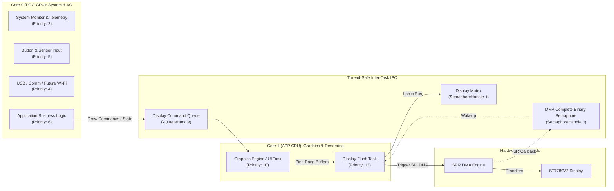

# Specification 002: FreeRTOS & Multicore Strategy

## 1. Objective & Scope

Define the FreeRTOS multi-core task architecture, CPU core affinities, inter-task communication (IPC), and thread synchronization strategies for the ESP32-S3 dual-core system driving the ST7789V2 display.

### Goals
- Isolate time-critical display rendering and SPI DMA transfers from system I/O and protocol tasks.
- Eliminate race conditions and SPI bus contention using deterministic synchronization primitives.
- Maximize frame throughput using double-buffered DMA ping-pong buffers.
- Establish clean FreeRTOS priority, stack sizing, and heap allocation conventions.

---

## 2. Dual-Core Allocation Strategy

The ESP32-S3 contains two Xtensa® 32-bit LX7 cores:
- **Core 0 (PRO CPU)**: Primary system control, connectivity, and external I/O.
- **Core 1 (APP CPU)**: Graphics rendering, frame calculations, and display updates.



### Rationale
Dedicating **Core 1** to graphics rendering ensures frame generation and DMA buffer preparation are never interrupted or jittered by background OS housekeeping, USB events, or network interrupts executing on Core 0.

---

## 3. Task Hierarchy & Priority Mapping

ESP-IDF FreeRTOS supports priority levels 0 through 24 (`configMAX_PRIORITIES = 25`). Higher numbers represent higher priority:

| Task Name | Assigned Core | Priority | Stack Size | Allocation | Purpose |
|---|:---:|:---:|:---:|:---:|---|
| **`disp_flush_task`** | Core 1 | **12** | 4 KB | Internal SRAM | Waits on DMA completion and sends buffer chunks to SPI |
| **`graphics_ui_task`** | Core 1 | **10** | 8 KB | Internal SRAM | Executes rendering logic (dirty rects, shapes, text, or LVGL loop) |
| **`app_logic_task`** | Core 0 | **6** | 4 KB | Internal SRAM | Main state machine, data processing, user interactions |
| **`input_sensor_task`**| Core 0 | **5** | 3 KB | Internal SRAM | Reads buttons, ADC, rotary encoders with software debounce |
| **`sys_telemetry_task`**| Core 0 | **2** | 3 KB | Internal SRAM | Periodically monitors FreeRTOS heap, CPU load, and FPS |

---

## 4. Display Pipeline & Synchronization

### 4.1 Double-Buffered Ping-Pong DMA Architecture

To achieve smooth rendering without screen tearing or CPU blocking:
1. Two line/slice buffers (`Buffer A` and `Buffer B`) are allocated in internal DMA-capable SRAM:
   $$\text{Slice Buffer Size} = 240 \times 40 \text{ pixels} \times 2 \text{ bytes} = 19,200 \text{ bytes}~(18.75\text{ KiB})$$
2. **Ping-Pong Execution Flow**:
   - Core 1 renders frame slice $N$ into **Buffer A**.
   - Core 1 triggers SPI DMA transfer of **Buffer A**.
   - While SPI DMA transmits **Buffer A** in hardware, Core 1 simultaneously renders frame slice $N+1$ into **Buffer B**.
   - Core 1 waits on the binary semaphore `dma_done_sem` signaled by the SPI DMA ISR before swapping buffers.

### 4.2 Mutex Protection for Display Bus
If multiple tasks ever need direct display access (e.g. status overlay or emergency error display):
- A recursive or standard mutex `xDisplayMutex` guards all SPI bus transactions.
- Transactions are wrapped with timeout protection:
  ```c
  if (xSemaphoreTake(s_display_mutex, pdMS_TO_TICKS(100)) == pdTRUE) {
      esp_lcd_panel_draw_bitmap(panel, x_start, y_start, x_end, y_end, buffer);
      xSemaphoreGive(s_display_mutex);
  }
  ```

### 4.3 Command Queue Protocol
Application tasks on Core 0 send draw/update commands to Core 1 via a FreeRTOS queue (`xDisplayCmdQueue`):
```c
typedef enum {
    DISP_CMD_CLEAR,
    DISP_CMD_DRAW_RECT,
    DISP_CMD_UPDATE_TEXT,
    DISP_CMD_SET_BACKLIGHT,
} disp_cmd_type_t;

typedef struct {
    disp_cmd_type_t type;
    union {
        struct { uint16_t color; } clear;
        struct { uint16_t x; uint16_t y; uint16_t w; uint16_t h; uint16_t color; } rect;
        struct { uint8_t brightness_pct; } backlight;
    } payload;
} disp_cmd_t;
```

---

## 5. Memory Management Guidelines

### Internal SRAM vs. External PSRAM
- **Task Stacks**: Always allocate task stacks in **internal SRAM** (`pvPortMallocStack` / default `xTaskCreatePinnedToCore`). Running task stacks in external PSRAM incurs cache-miss latency penalties.
- **DMA Buffers**: **Must** be allocated in internal SRAM using `heap_caps_malloc(size, MALLOC_CAP_DMA | MALLOC_CAP_INTERNAL)`. The ESP32-S3 SPI DMA controller cannot directly access external PSRAM without specialized cache writeback configurations.
- **Large Assets & Full Frame Back-buffers**: Can reside in the 2 MB PSRAM (`MALLOC_CAP_SPIRAM`), then copied into the smaller internal SRAM DMA slice buffers during the flush cycle.

---

## 6. Implementation Milestones

1. **Milestone 1: Synchronization Primitives**:
   - Create `xDisplayMutex` and `dma_done_sem`.
   - Register the `esp_lcd` DMA finish callback (`on_color_trans_done`) to release `dma_done_sem`.
2. **Milestone 2: Dedicated Core 1 Graphics Task**:
   - Create `graphics_ui_task` pinned to `1` with priority `10`.
   - Demonstrate continuous non-blocking animation (e.g. moving shape or bouncing box) running on Core 1.
3. **Milestone 3: Core 0 Command Generator**:
   - Create `app_logic_task` pinned to `0` with priority `6`.
   - Send commands over `xDisplayCmdQueue` to alter graphic properties on Core 1 without frame drops.
4. **Milestone 4: Performance Telemetry**:
   - Integrate CPU runtime stats (`vTaskGetRunTimeStats`) and FPS counter on Core 0.

---

## 7. Acceptance & Verification Criteria

- [ ] **Dual-Core Verification**: Task list confirms `graphics_ui_task` runs on CPU 1 and application tasks run on CPU 0.
- [ ] **Lockup Prevention**: Simulated Core 0 heavy computation does not cause frame stutter or watchdog timeouts on Core 1.
- [ ] **Thread Safety**: Multiple tasks issuing display updates via the queue operate cleanly without memory corruption or SPI collision.
- [ ] **Memory Verification**: Zero stack overflow detections (`configCHECK_FOR_STACK_OVERFLOW = 2`) and healthy internal SRAM heap headroom.

